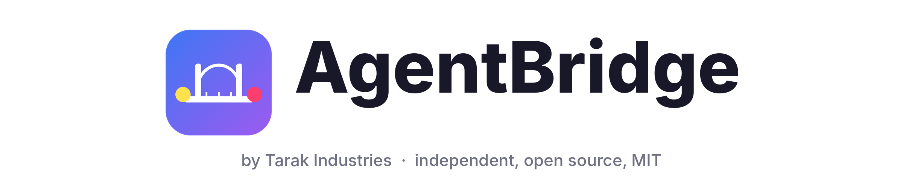
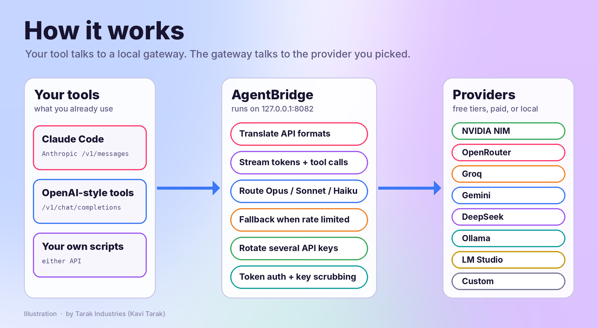
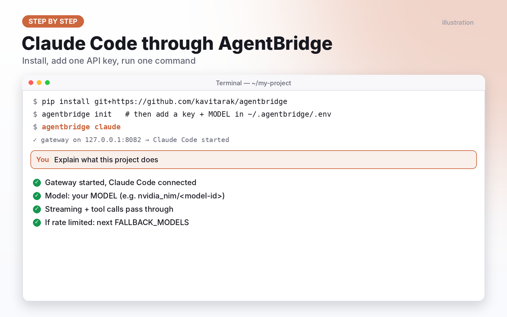
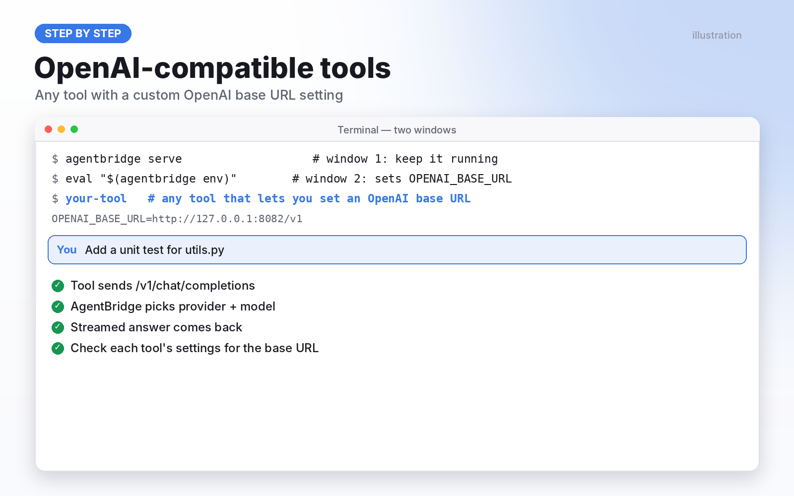
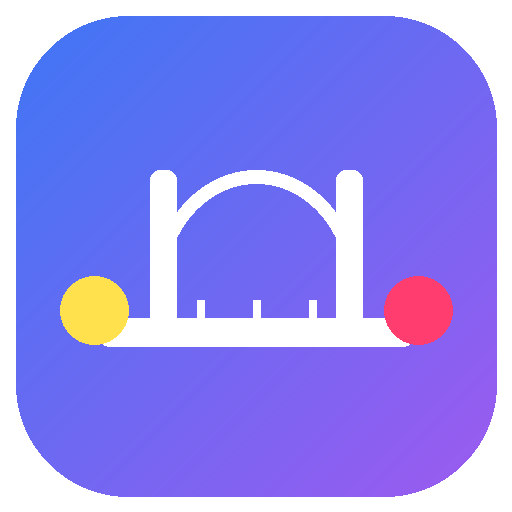

<p align="center">
  
</p>

<p align="center">
  <a href="LICENSE"></a>
  
  
  <a href="https://github.com/kavitarak/Free-claude-code-use-/actions"></a>
</p>
<p align="center">
  
  
  
  
</p>

<p align="center">
  <a href="#-quick-start">Quick Start</a> ·
  <a href="#-providers">Providers</a> ·
  <a href="#-what-works-with-what">Compatibility</a> ·
  <a href="#%EF%B8%8F-settings">Settings</a> ·
  <a href="#-security">Security</a> ·
  <a href="#%EF%B8%8F-honest-limits">Limits</a> ·
  <a href="#%EF%B8%8F-roadmap">Roadmap</a>
</p>

<p align="center">
  <i>Independent open-source project. Not affiliated with or endorsed by Anthropic, OpenAI or any model provider. "Claude" and "Claude Code" are trademarks of Anthropic; AgentBridge only gives Claude Code a different backend through the gateway setting it already supports.</i>
</p>

<p align="center">
  <b>A small local gateway that lets Claude Code, and tools that speak the OpenAI chat API,<br>use the model provider <i>you</i> choose.</b><br>
  NVIDIA NIM · OpenRouter · Groq · Gemini · DeepSeek · Ollama · LM Studio · any OpenAI-compatible endpoint
</p>

---

## ✨ What it does

Claude Code speaks Anthropic's *Messages* API. Most other providers speak OpenAI's *chat completions* API. AgentBridge sits on your own machine and translates between the two, so you can run Claude Code on the models and keys you have.

<p align="center"></p>

- **Streaming and tool calls** work end to end, so Claude Code's file edits and shell tools keep working (how well depends on the model you pick).
- **Opus / Sonnet / Haiku routing**: give each Claude Code tier its own model, or one model for all.
- **Fallbacks**: if a model is rate limited or down, the next one in your list takes over.
- **Several keys per provider**: separate them with commas; AgentBridge rotates and skips a key that fails.
- **Private by default**: listens on `127.0.0.1` only, optional bearer token, never logs request bodies or keys, scrubs keys from error text.
- **Zero dependencies**: pure Python standard library. Nothing to compile, nothing to audit but this repo.
- **Also speaks OpenAI**: `/v1/chat/completions` works for any tool that lets you set an OpenAI-style base URL.

---

## ✅ What works with what

| Tool | Supported | How |
|---|---|---|
| **Claude Code** | ✅ Yes | `agentbridge claude` |
| **Tools with a custom OpenAI base URL** (chat completions) | ✅ Yes | `agentbridge env`, then check the tool's own settings |
| **OpenAI Codex** | ❌ Not yet | Current Codex versions only use the Responses API, which AgentBridge does not implement yet (see [Roadmap](#-roadmap)) |
| **Gemini CLI, Antigravity** | ❌ No | They talk to Google's own endpoints, not to an OpenAI or Anthropic one |
| **Claude.ai (web, mobile)** | ❌ No | Hosted by Anthropic, nothing to point elsewhere |

---

## 🚀 Quick start

```bash
pip install git+https://github.com/kavitarak/Free-claude-code-use-.git
agentbridge init          # creates ~/.agentbridge/.env (private, mode 600)
```

Open `~/.agentbridge/.env`, add **one** API key and set `MODEL`:

```ini
NVIDIA_NIM_API_KEY=your-key-here
MODEL=nvidia_nim/<model-id>
```

Model ids change often, so copy the exact id from your provider's model page. Then:

```bash
agentbridge doctor        # checks your settings, never prints your keys
agentbridge claude        # starts the gateway and Claude Code together
```

<p align="center"></p>

`agentbridge claude` starts the gateway in the background, points Claude Code at it, and stops it when you quit. Extra arguments go straight to Claude Code, for example `agentbridge claude -p "explain this repo"`. Gateway logs go to `~/.agentbridge/agentbridge.log`, so your Claude Code screen stays clean.

### Other tools (OpenAI chat API)

```bash
agentbridge serve                    # window 1: keep it running
eval "$(agentbridge env)"            # window 2 (PowerShell: agentbridge env --shell powershell | iex)
your-tool                            # any tool that reads OPENAI_BASE_URL / OPENAI_API_KEY
```

Some tools use different setting names. The gateway address is `http://127.0.0.1:8082/v1`; the API key can be any text unless you set `AGENTBRIDGE_AUTH_TOKEN`.

<p align="center"></p>

<sub>The screenshots are illustrations of the workflow, not real recordings.</sub>

---

## 🔌 Providers

| Name in `MODEL` | Key variable | Default address |
|---|---|---|
| `nvidia_nim` | `NVIDIA_NIM_API_KEY` | `https://integrate.api.nvidia.com/v1` |
| `openrouter` | `OPENROUTER_API_KEY` | `https://openrouter.ai/api/v1` |
| `groq` | `GROQ_API_KEY` | `https://api.groq.com/openai/v1` |
| `gemini` | `GEMINI_API_KEY` | `https://generativelanguage.googleapis.com/v1beta/openai` |
| `deepseek` | `DEEPSEEK_API_KEY` | `https://api.deepseek.com/v1` |
| `ollama` | none | `http://localhost:11434/v1` (`OLLAMA_BASE_URL`) |
| `lmstudio` | none | `http://localhost:1234/v1` (`LMSTUDIO_BASE_URL`) |
| `custom` | `CUSTOM_API_KEY` | your `CUSTOM_BASE_URL` |

A model is written as `provider/model-id`, for example `openrouter/vendor/some-model:free`. Everything after the first `/` is sent to the provider unchanged.

> **Free tiers and terms.** Free-tier limits, model lists and terms are set by each provider and can change. Check them yourself, and only use a provider in ways its terms allow.

---

## ⚙️ Settings

Put these in `~/.agentbridge/.env` (or set them as environment variables; the environment wins).

| Setting | Meaning | Default |
|---|---|---|
| `MODEL` | Model used for every request | required |
| `MODEL_OPUS`, `MODEL_SONNET`, `MODEL_HAIKU` | Override one Claude Code tier | uses `MODEL` |
| `FALLBACK_MODELS` | Comma list tried in order on 404, 408, 409, 425, 429, 500-504, 529 or connection errors (and on 401/403 once every key of a provider failed) | none |
| `*_API_KEY` | Provider keys; commas for several keys | none |
| `AGENTBRIDGE_PORT` | Port to listen on | `8082` |
| `AGENTBRIDGE_HOST` | Address to listen on | `127.0.0.1` |
| `AGENTBRIDGE_AUTH_TOKEN` | If set, every request must carry it | off |
| `MAX_CONCURRENCY` | Provider requests at the same time | `4` |
| `REQUEST_TIMEOUT` | Seconds to wait for a provider | `120` |

Client errors (400, 422 and similar) are returned straight away; AgentBridge does not hide a bad request behind a fallback.

---

## 🔒 Security

- Listens on **localhost only**. It refuses to start on another address without `AGENTBRIDGE_AUTH_TOKEN`.
- Your keys stay in `~/.agentbridge/.env` (created with mode 600; `agentbridge doctor` warns if it is readable by others). Never commit that file.
- Request bodies and headers are **never logged**; provider error text has your keys replaced with `***` before it reaches logs or clients.
- `agentbridge claude` removes `ANTHROPIC_API_KEY` from the environment it passes on, so a real Anthropic key is never sent to the gateway.
- No telemetry. The only network calls are to the provider you configured.

Found a problem? See [SECURITY.md](SECURITY.md).

---

## ⚠️ Honest limits

- **Quality depends on the model.** Smaller or free models may handle Claude Code's tools badly.
- **Thinking blocks are dropped.** Provider-specific reasoning output is not passed to Claude Code.
- **Images** only work if the chosen model accepts them.
- **Token counts** from `/v1/messages/count_tokens` are rough estimates (about 4 characters per token).
- **No Responses API, no admin web page, no chat bots** in this version.
- Tested here against a fake provider and the real Claude Code CLI. Each real provider can behave a little differently, so please [open an issue](https://github.com/kavitarak/Free-claude-code-use-/issues) if one does.

---

## 🗺️ Roadmap

- [ ] `/v1/responses` support, so Codex-style tools can connect
- [ ] Optional web page to manage keys and models
- [ ] Per-provider quirks list (stream options, reasoning fields)
- [ ] Windows installer script

---

## 🧑‍💻 Development

```bash
git clone https://github.com/kavitarak/Free-claude-code-use-.git && cd Free-claude-code-use-
python -m unittest discover -s tests -t .
```

Tests include an end-to-end suite that starts the real gateway against a fake provider (fallbacks, key rotation, auth, streaming, tool calls, secret scrubbing). Pull requests are welcome, see [CONTRIBUTING.md](CONTRIBUTING.md).

AgentBridge is an independent, from-scratch implementation under the MIT license. It was inspired by the general idea behind projects such as Free Claude Code (AGPL-3.0) and Claude Code Router, and uses none of their code.

---

## 📜 License

<table>
<tr>
<td width="90" align="center"></td>
<td>

**MIT License.** Free for personal and commercial use. Copy, modify and share; just keep the copyright notice. See [LICENSE](LICENSE).

<sub>Copyright © 2026 Hemant Tarak (kavi.onlines) · Tarak Industries</sub>

</td>
</tr>
</table>

---

<p align="center">
  Made with ❤️ by <b>Tarak Industries</b> (Kavi Tarak)<br>
  <a href="https://www.youtube.com/@kavi.online">YouTube</a> ·
  <a href="https://t.me/kavitarak">Telegram</a> ·
  <a href="https://linkedin.com/in/hemanttarak">LinkedIn</a><br>
  <sub>⭐ Star this repo if it helped you!</sub>
</p>
